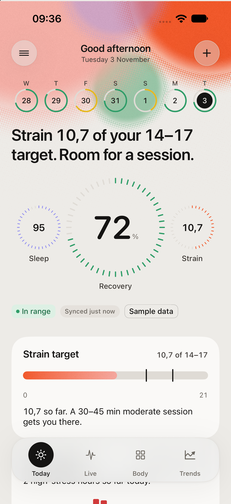
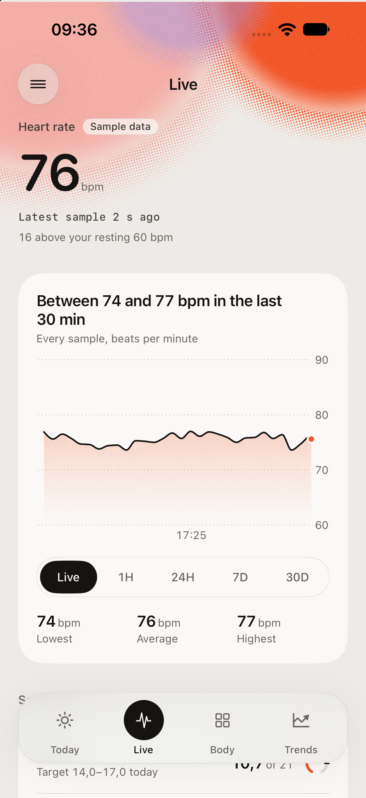
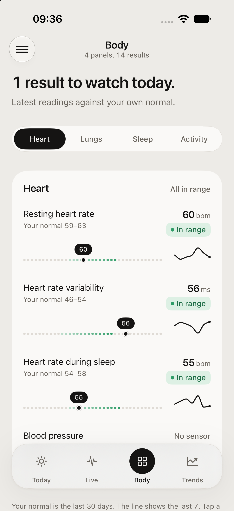
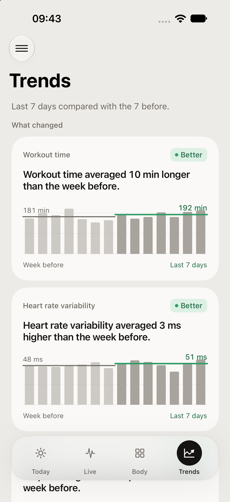

# MRH1

**Recovery, strain and sleep scores for your Fitbit Air, explained like a lab result. On-device. No subscription.**

Works with Fitbit Air via Google Health and Apple Health. Not affiliated with Google, Fitbit or Apple.

<p align="center">
  
  
  
  
</p>

> Screenshots and the web demo use **synthetic sample data**, not real health readings.

## What it does

- **Today:** Recovery, Sleep and Strain tick rings, a time-of-day verdict, strain target, 24-hour stress, health-monitor heat map, last night, sleep debt, your week, journal discoveries.
- **Live:** latest heart rate with a "latest sample N min ago" ticker, Live · 1H · 24H · 7D · 30D chart with min / avg / max, strain, stress, steps and energy so far today, last night's breathing and SpO2. Optional Bluetooth heart rate (beta, off by default).
- **Body:** every metric as a lab result: value, your personal normal, a dot-matrix range strip and a 7-day line. Metrics Google Health doesn't send (HRV, skin temperature, VO2 max) say so, never zero.
- **Trends:** what changed this week versus last, in one sentence per metric. Weekly report with a share export, body age.
- **Score details:** every input to a score, its weight, and how it's computed.

## How it works

```
Fitbit Air ──► Google Health ──► Apple Health ──► MRH1 (on this iPhone)
```

- Native iOS 17+, SwiftUI, Swift Charts, HealthKit (read-only), Metal shaders for the header and chart texture.
- No networking code, no analytics, no third-party packages. Baselines come from your own last 30 days.
- Google Health writes to Apple Health in batches, so "Live" is as fresh as the latest sync, and the app always shows how old it is.

## Build

1. Open `MRH1.xcodeproj` in Xcode (26 or later; the Metal Toolchain component must be installed: `xcodebuild -downloadComponent MetalToolchain`).
2. Select the MRH1 target → Signing & Capabilities → choose your team.
3. Run on an iPhone. In the Simulator the app runs on deterministic sample data (`-demo`); pass `-realHealth` to read HealthKit instead.

Screenshot launch arguments: `-tab today|live|body|trends`, `-open recovery|strain|sleep|menu|journal`, `-uiLight` / `-uiDark`, `-demoNow 17:40`.

## Repository

| Path | What |
|---|---|
| `MRH1/` | App source |
| `web/` | Landing page and browser demo (WebGL2), synthetic data |
| `DESIGN_SPEC.md` | Design system: tokens, type, charts, motion, copy rules |
| `research/` | Research behind the design (brands, competitors, UI craft, live data, graphics, market) |
| `screenshots/v1/` | Simulator screenshots, light and dark |

---

MRH1 gives wellness estimates, not medical advice. © 2026. All rights reserved.
